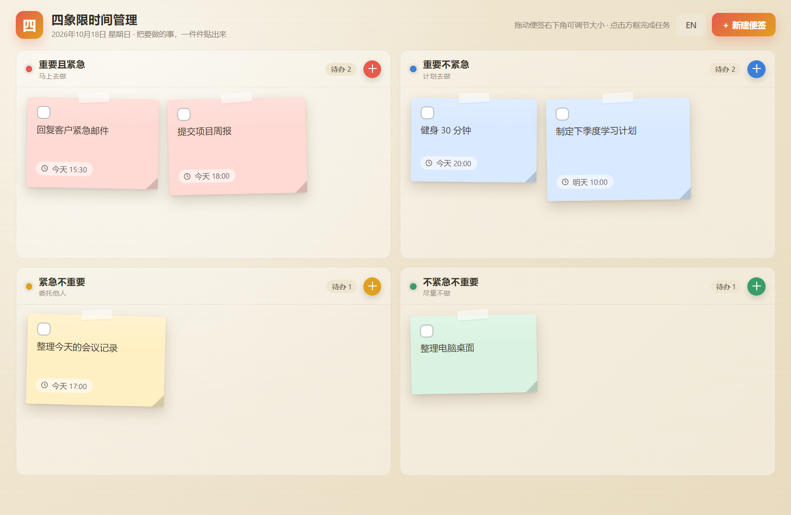

# Quadrant Notes · 四象限便签

A cross-platform (Windows / macOS) desktop sticky-note app that manages your daily tasks with the Eisenhower Matrix (urgent / important).

English · [简体中文](README.md)


## Preview



## Features

- **Eisenhower quadrant board**: Urgent & Important (do it now), Important & Not Urgent (plan it), Urgent & Not Important (delegate it), Not Urgent & Not Important (skip it) — each quadrant has its own color and action hint
- **Time capsule**: attach a time to a task; shown as friendly labels like "Today 18:00" / "Tomorrow 10:00"; overdue times turn red automatically
- **Mark as done**: completed notes fade out with a strikethrough and move to the end of the quadrant; a live to-do counter sits in each quadrant header
- **Free resizing**: drag the folded corner at the bottom-right of a note to resize it
- **Bilingual UI**: switch between Chinese and English with one click; your choice is remembered
- **Local data storage**: data is stored on your machine, works offline, and survives restarts; sample notes included on first launch
- **Zero-dependency runtime**: the packaged app is a single portable file — no installation, no network required

## Download

Grab the latest build from the [Releases](https://github.com/gsk74521/Quadrant-Notes/releases) page:

| Platform | File | Notes |
| -------- | ---- | ----- |
| Windows | `Quadrant-Notes-1.1.0-x64.exe` | Portable — double-click to run, no installation |
| macOS (Apple Silicon) | `Quadrant-Notes-1.1.0-arm64.dmg` | Drag into Applications |
| macOS (Intel) | `Quadrant-Notes-1.1.0-x64.dmg` | Drag into Applications |

> On macOS, if you see "cannot be opened because the developer cannot be verified", allow it under System Settings → Privacy & Security.

## Run from source

Requires [Node.js](https://nodejs.org) (>= 18):

```bash
npm install
npm start
```

## Build

```bash
# Windows portable exe
npm run dist:win

# macOS dmg (must run on macOS or Linux; dmg cannot be built on Windows)
npm run dist:mac
```

Build artifacts are written to `dist/`. App icons are generated by `render-icons.js` (`node render-icons.js`).

## Testing

See [TEST.md](TEST.md) for the manual test checklist, covering 9 groups: launch, adding notes, time display, completion, resizing, deletion, bilingual UI, data persistence and cross-platform behavior.

## Tech stack

- [Electron](https://www.electronjs.org/) 33 (main process + renderer, contextIsolation enabled)
- Plain HTML / CSS / JavaScript in the renderer — no frontend framework
- Data storage: localStorage

## Project layout

```
├── main.js           # Electron main process (window, menu)
├── renderer/         # Renderer (index.html / app.js / styles.css)
├── build/            # App icons and style drafts
├── docs/             # Documentation images
├── render-icons.js   # Icon generation script
└── dist/             # Build output (git-ignored)
```

## License

[MIT](LICENSE)
